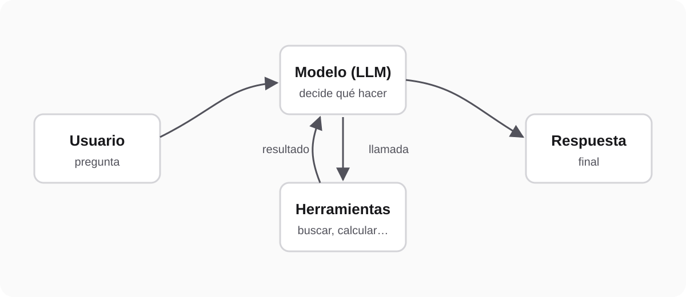

A **chatbot** answers with text. An **agent** decides what to do: it queries a database, calls an API, checks the result and repeats until the task is done. The difference isn't the model, it's the loop around it.

I build agents every day: at Tata Consultancy Services, on AWS Bedrock with LangChain, and at NEXOR ONE, my own platform, with the Claude API, where agents answer customers over WhatsApp and email. In this article we build a small but complete agent, with no frameworks, to see exactly what happens at each step.

## The agent loop

Every agent, however complex, repeats the same four steps:

1. It receives a request.
2. The model decides whether it can answer or needs a tool.
3. If it needs one, **your code** runs it and hands back the result.
4. Repeat until the model has the final answer.



The model never runs anything on its own: it only asks. Your code is what runs, validates and decides what's allowed. That separation is what makes an agent safe to put in production.

## What you need

- Python 3.10 or later.
- The official SDK: `pip install anthropic`.
- A [Claude](https://platform.claude.com) API key in the `ANTHROPIC_API_KEY` environment variable.

## The complete agent

It's an inventory assistant with a single tool, `check_stock`. Save it as `agent.py` and run it with `python agent.py`:

```python
import json

import anthropic

client = anthropic.Anthropic()  # Reads ANTHROPIC_API_KEY from the environment.

# 1. Tools are plain Python functions.
INVENTORY = {"keyboard": 12, "mouse": 0, "monitor": 3}


def check_stock(product: str) -> dict:
    product = product.strip().lower()
    if product not in INVENTORY:
        raise ValueError(f"There is no product called '{product}'.")
    return {"product": product, "units": INVENTORY[product]}


# 2. The model sees each tool as a JSON Schema description.
TOOLS = [
    {
        "name": "check_stock",
        "description": (
            "Returns how many units of a product are in the warehouse. "
            "Use it before stating whether something is available."
        ),
        "input_schema": {
            "type": "object",
            "properties": {
                "product": {
                    "type": "string",
                    "description": "Product name, for example 'keyboard'.",
                }
            },
            "required": ["product"],
            "additionalProperties": False,
        },
        "strict": True,  # Arguments always match the schema.
    }
]
FUNCTIONS = {"check_stock": check_stock}


# 3. Runs one call from the model and turns it into a result.
def run_tool(call) -> dict:
    result = {"type": "tool_result", "tool_use_id": call.id}
    try:
        output = FUNCTIONS[call.name](**call.input)
        result["content"] = json.dumps(output)
    except Exception as error:
        # The model gets the error back and can fix its next step.
        result["content"] = f"Error: {error}"
        result["is_error"] = True
    print(f"[tool] {call.name}({call.input}) -> {result['content']}")
    return result


# 4. The loop: the model asks for tools until it can answer.
def run_agent(question: str, max_turns: int = 5) -> str:
    messages = [{"role": "user", "content": question}]

    for _ in range(max_turns):
        response = client.beta.messages.create(
            model="claude-opus-5-5",
            max_tokens=16000,
            system="You are a store's inventory assistant. Answer in a few lines.",
            tools=TOOLS,
            messages=messages,
            # If the model declines the request, the API retries it on another model.
            betas=["server-side-fallback-2026-07-01"],
            fallbacks="default",
        )

        if response.stop_reason == "refusal":
            return "I can't help with that request."

        # Keep the model's full turn: text and tool calls.
        messages.append({"role": "assistant", "content": response.content})

        if response.stop_reason != "tool_use":
            return "".join(b.text for b in response.content if b.type == "text")

        # Every call in the turn is answered together, in a single message.
        calls = [b for b in response.content if b.type == "tool_use"]
        messages.append({"role": "user", "content": [run_tool(b) for b in calls]})

    return "I couldn't finish the task within the allowed number of steps."


if __name__ == "__main__":
    print(run_agent("Do I have enough stock to put together 5 keyboard-and-mouse bundles?"))
```

## Step by step

### 1. The tool is a plain function

`check_stock` knows nothing about AI: it takes a product and returns the units. If the product doesn't exist, it raises an error like any other function. In a real system, this is where your database or API query goes.

### 2. The model only sees a description

To the model, a tool is its name, a **description** and a **JSON Schema** for the arguments. The description matters more than it looks: it's what the model reads to decide when to use the tool. "Use it before stating whether something is available" stops it from making up an answer without checking.

With `"strict": True`, the API guarantees that the arguments match the schema: you won't get a number where you expected text.

### 3. Errors go back to the model

When a tool fails, the program doesn't stop: the error goes back to the model with `is_error`. In practice the model reads it and corrects itself: if it asked for "mice" and that doesn't exist, it tries again with "mouse". Notice the `print` too: it's the log of every action, and in production it isn't optional (more on that below).

### 4. The loop and its exit condition

The key is `stop_reason`:

- `tool_use`: the model asked for one or more tools. You run them and send **all** the results back together, in a single message.
- Any other value: the model is done and its text is the answer.

On every pass, `messages` keeps the model's full turn, not just its text. The API has no memory between calls: the history you send is all it knows.

<Callout type="tip">
  Always set a turn limit (`max_turns`). Without one, a confused agent can keep calling tools in a loop and burn tokens nonstop.
</Callout>

## What happens when you run it

With the question "Do I have enough stock to put together 5 keyboard-and-mouse bundles?", the model doesn't answer from memory: it asks `check_stock` for the keyboard and for the mouse (usually both in the same turn), gets 12 and 0, and replies that there isn't enough because there are no mice. In the console you see one `[tool]` line per lookup, before the final answer.

That back-and-forth is the whole trick. The rest is adding tools.

## Taking it to production

The example fits in 90 lines. What separates an example from a production agent are these rules:

- **Log every action somewhere it can't be edited.** In NEXOR ONE, every action that changes data goes into a table that only accepts inserts: which tool the agent used, with which parameters and what it got back. Without that log there's no way to audit an agent that acts unsupervised.
- **Validate in your code, not in the prompt.** The strict schema guarantees the format, but whether the customer exists or the amount makes sense is decided by your function before anything runs.
- **Separate reading from writing.** Start with read-only tools. The ones that create, change or send something come later, and the most sensitive ones go through a person's approval first.
- **Reply fast, process separately.** If the agent works over WhatsApp or a webhook, return the HTTP response right away and run the agent loop in a background worker: providers retry, or mark an endpoint as down, when it takes too long.

## Next step

Add a second tool, for example `check_price`, and ask how much the bundles you *can* put together would cost. Watch the model chain both tools on its own: that's the moment an agent starts being useful.
